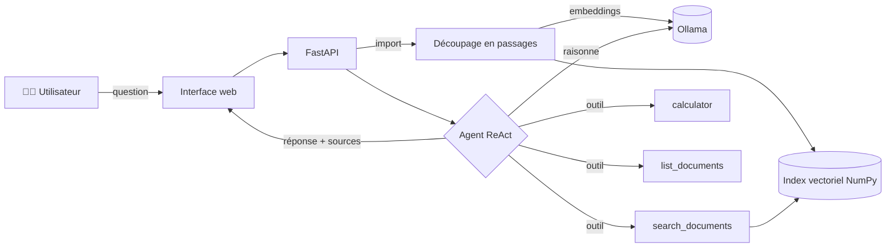

# 🧠 DocMind — Agent RAG qui répond aux questions à partir de vos documents

> Importez vos PDF, notes ou règlements, puis posez vos questions en langage naturel.
> Un **agent LLM** choisit lui-même ses outils (recherche sémantique, calculatrice…), lit les passages utiles et répond **en citant ses sources**.
> Tout tourne **en local** avec Ollama : aucune donnée ne quitte votre machine.


---

## ✨ Fonctionnalités

- 📄 **Import de documents** PDF, TXT et Markdown (glisser-déposer dans l'interface)
- ✂️ **Découpage intelligent** en passages avec chevauchement, coupés en fin de phrase
- 🔎 **Recherche sémantique** par embeddings (`nomic-embed-text`) et similarité cosinus
- 🤖 **Agent ReAct** : le LLM raisonne étape par étape et choisit ses outils
  - `search_documents` : cherche les passages les plus proches de la question
  - `list_documents` : liste les documents disponibles
  - `calculator` : calculs exacts, sans `eval` (analyse de l'arbre syntaxique)
- 📌 **Réponses sourcées** (`fichier p.X`) et refus de répondre quand l'information n'est pas dans les documents
- 💬 **Mémoire de conversation** : les questions de suivi gardent le contexte
- 🪟 **Interface web** sombre et claire, avec le **raisonnement de l'agent** affiché étape par étape
- 🛡️ Gestion propre des erreurs (LLM arrêté → `503` avec un message clair)

## 🏗️ Architecture



### Boucle de l'agent

À chaque étape, le modèle répond avec un objet JSON (format imposé par Ollama) :

```json
{"thought": "Je dois chercher la règle sur les congés", "action": "search_documents", "input": "congés payés"}
```

L'outil est exécuté, son résultat est renvoyé au modèle, et la boucle continue jusqu'à :

```json
{"thought": "J'ai l'information", "final_answer": "30 jours ouvrables par an.", "sources": ["reglement-interieur.md p.1"]}
```

Le nombre d'étapes est limité (`MAX_STEPS`) pour éviter les boucles infinies, et une réponse mal formée est redemandée au modèle.

## 🚀 Lancer le projet

### Avec Docker (recommandé)

```bash
git clone https://github.com/mayssadhahri1/docmind-rag-agent.git
cd docmind-rag-agent
docker compose up -d          # lance Ollama, télécharge les modèles, puis l'API
```

Ouvrir **http://localhost:8000**, importer `examples/reglement-interieur.md` et demander :
*« Combien de jours de télétravail sont autorisés ? »*

### Sans Docker

```bash
# 1. Installer Ollama (https://ollama.com) puis :
ollama pull llama3.2
ollama pull nomic-embed-text

# 2. Lancer l'API
python -m venv .venv && source .venv/bin/activate
pip install -r requirements.txt
uvicorn app.main:app --reload
```

### Configuration

| Variable | Valeur par défaut | Rôle |
|---|---|---|
| `OLLAMA_URL` | `http://localhost:11434` | Adresse du serveur Ollama |
| `CHAT_MODEL` | `llama3.2` | Modèle utilisé par l'agent |
| `EMBED_MODEL` | `nomic-embed-text` | Modèle d'embeddings |
| `CHUNK_SIZE` / `CHUNK_OVERLAP` | `800` / `150` | Taille des passages et chevauchement |
| `TOP_K` | `4` | Passages renvoyés par recherche |
| `MAX_STEPS` | `5` | Étapes maximum de l'agent |
| `DATA_DIR` | `data` | Dossier de l'index vectoriel |

## 🔌 API

Documentation interactive : **http://localhost:8000/docs**

| Méthode | Route | Description |
|---|---|---|
| `GET` | `/health` | État de l'API, du LLM et nombre de passages indexés |
| `GET` | `/documents` | Documents indexés |
| `POST` | `/documents` | Importer un document (`multipart/form-data`) |
| `DELETE` | `/documents/{nom}` | Retirer un document de l'index |
| `POST` | `/ask` | Poser une question (`{"question": "...", "history": [...]}`) |

```bash
curl -F file=@examples/reglement-interieur.md localhost:8000/documents
curl -X POST localhost:8000/ask -H "Content-Type: application/json" \
     -d '{"question": "Quel est le plafond pour un repas ?"}'
```

## 🧪 Tests et qualité

Les tests n'ont **pas besoin d'un vrai LLM** : un faux modèle « scripté » rejoue des réponses prévues, ce qui permet de tester la boucle de l'agent de façon déterministe.

```bash
pip install -r requirements-dev.txt
pytest -q        # 21 tests : découpage, index vectoriel, agent, API
ruff check .     # lint
```

La CI GitHub Actions lance le lint, les tests, construit l'image Docker et vérifie qu'elle démarre.

## 📁 Structure

```
app/
├── main.py         # API FastAPI + gestion des erreurs
├── agent.py        # Agent ReAct, outils, calculatrice sûre
├── llm.py          # Client Ollama + faux modèles pour les tests
├── ingest.py       # Lecture PDF/TXT/MD et découpage
├── vectorstore.py  # Index vectoriel NumPy sauvegardé sur disque
├── config.py       # Configuration par variables d'environnement
└── static/index.html  # Interface web
tests/              # Tests unitaires et d'API
examples/           # Document d'exemple
```

## 🛣️ Pistes d'amélioration

- Recherche hybride (BM25 + vecteurs) et re-ranking des passages
- Réponses en streaming (Server-Sent Events)
- Base vectorielle dédiée (Qdrant, pgvector) pour de gros volumes
- Évaluation automatique de la qualité des réponses (jeu de questions de référence)

---

👩‍💻 **Mayssa Dhahri** — Élève-ingénieure en Génie Logiciel, École Polytechnique de Sousse
[LinkedIn](https://www.linkedin.com/in/mayssa-dhahri/) · [GitHub](https://github.com/mayssadhahri1)

*Réalisé avec l'aide d'un assistant IA.*
